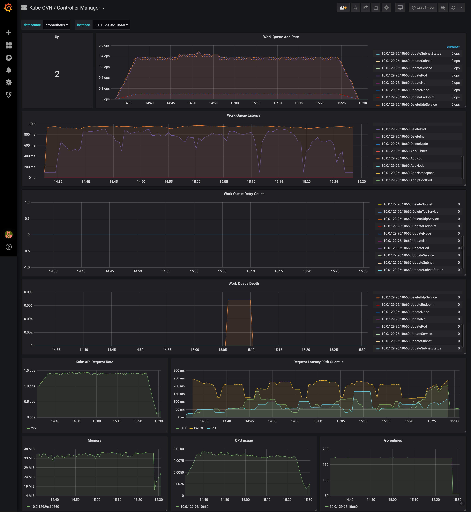
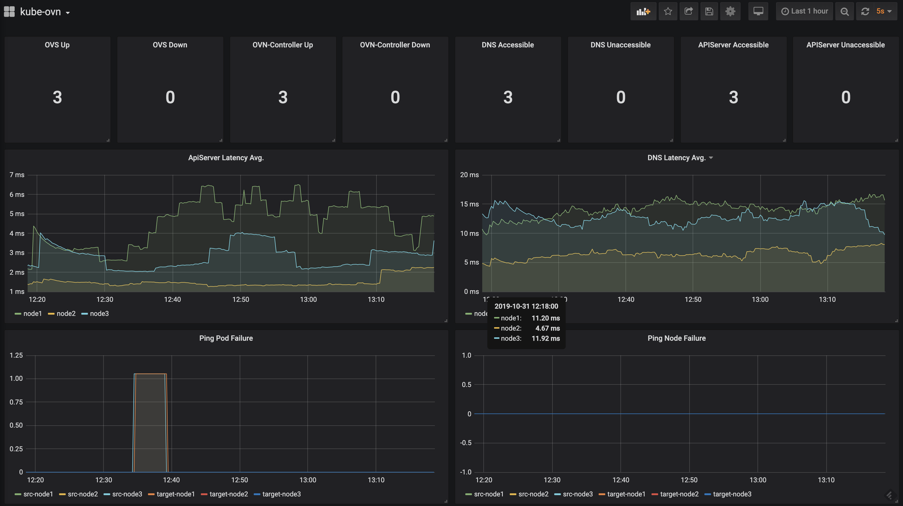
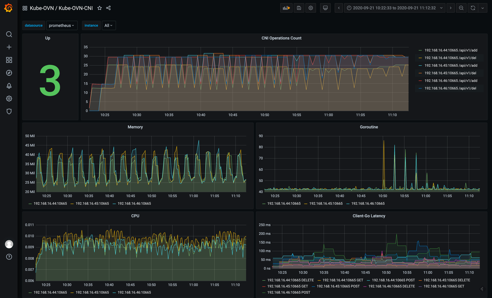

# Monitor and Dashboard

Kube-OVN can export network control plane information and network data plane quality information metrics to the external in formats supported by Prometheus.

We use the CRD provided by [kube-prometheus](https://github.com/coreos/kube-prometheus) to define the corresponding Prometheus monitoring rules.
For all monitoring metrics supported by Kube-OVN, please refer to [Kube-OVN Monitoring Metrics](../reference/metrics.en.md).

## Install Prometheus Monitor

Kube-OVN uses Prometheus Monitor CRD to manage the monitoring output.

```bash
# network quality related monitoring metrics
kubectl apply -f https://raw.githubusercontent.com/kubeovn/kube-ovn/master/dist/monitoring/pinger-monitor.yaml
# kube-ovn-controller metrics
kubectl apply -f https://raw.githubusercontent.com/kubeovn/kube-ovn/master/dist/monitoring/controller-monitor.yaml
# kube-ovn-cni metrics
kubectl apply -f https://raw.githubusercontent.com/kubeovn/kube-ovn/master/dist/monitoring/cni-monitor.yaml
# ovn metrics
kubectl apply -f https://raw.githubusercontent.com/kubeovn/kube-ovn/master/dist/monitoring/ovn-monitor.yaml
```

The default interval for Prometheus pull is 15s, if you need to adjust it, modify the `interval` value in yaml.

## Deploy Monitoring Resources with the kube-ovn-v2 Helm Chart

The `kube-ovn-v2` Helm chart can create the bundled `PrometheusRule` and Grafana dashboard ConfigMaps. Both features are disabled by default. Install the Prometheus Operator CRDs first; dashboard ConfigMaps also require the kube-prometheus-stack Grafana sidecar to watch the `grafana_dashboard: "1"` label.

The following values enable both features and place their resources in the `monitoring` namespace:

```yaml
prometheusRule:
  enabled: true
  namespace: monitoring
  labels:
    release: kube-prometheus-stack
grafanaDashboards:
  enabled: true
  namespace: monitoring
  datasource: Prometheus
```

Pass this file when installing or upgrading the chart:

```bash
helm upgrade --install kube-ovn oci://ghcr.io/kubeovn/charts/kube-ovn-v2 \
  --namespace kube-system \
  --values monitoring-values.yaml
```

`prometheusRule` includes the baseline Kube-OVN alert rules. These alerts depend on metrics being scraped from the controller, OVN monitor, pinger, and agent; enable the matching component `serviceMonitor.enabled` values in the chart or configure an external scrape. Use `prometheusRule.additionalGroups` to append custom groups that follow the `PrometheusRule.spec.groups[]` schema.

`grafanaDashboards.datasource` must contain only letters, numbers, dots, underscores, or hyphens. It defaults to `Prometheus`. The chart replaces the `${DS_PROMETHEUS}` placeholders in the bundled dashboards with this name.

## Import Grafana Dashboard

Kube-OVN provides a predefined Grafana Dashboard to display control plane and data plane related metrics.

Download the corresponding Dashboard template:

```bash
# network quality related monitoring dashboard
wget https://raw.githubusercontent.com/kubeovn/kube-ovn/master/dist/monitoring/pinger-grafana.json
# kube-ovn-controller dashboard
wget https://raw.githubusercontent.com/kubeovn/kube-ovn/master/dist/monitoring/controller-grafana.json
# kube-ovn-cni dashboard
wget https://raw.githubusercontent.com/kubeovn/kube-ovn/master/dist/monitoring/cni-grafana.json
# ovn dashboard
wget https://raw.githubusercontent.com/kubeovn/kube-ovn/master/dist/monitoring/ovn-grafana.json
# ovs dashboard
wget https://raw.githubusercontent.com/kubeovn/kube-ovn/master/dist/monitoring/ovs-grafana.json
```

Import these templates into Grafana and set the data source to the corresponding Prometheus to see the following Dashboards.

`kube-ovn-controller` dashboard:



`kube-ovn-pinger` dashboard:



`kube-ovn-cni` dashboard:


